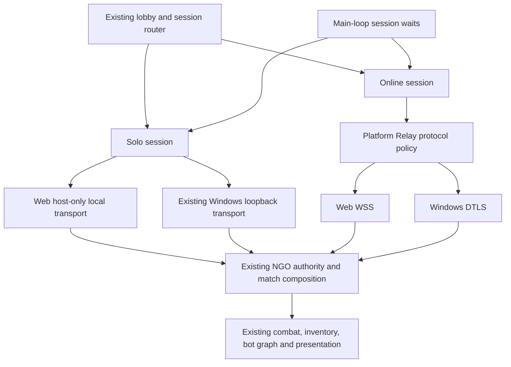
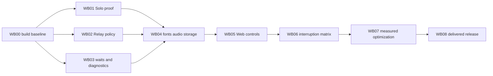

# WebGL implementation plan — 2026-10-19

## 1. Authorization, branch and scope

The user authorized a separate Git branch and a detailed implementation plan only. No implementation, package/module installation, target switch, scene edit, production build or deployment is part of this planning task.

- Branch: `codex/webgl-build`, based on main `f2e7e08261f782c0a2a90ce4eb4f83f51db3766b`.
- Working checkout: `C:/Users/paek6/Absolute Zero`.
- Intended upstream: `origin/codex/webgl-build`.
- Existing open Editor: `C:/Users/paek6/AbsoluteZero-SoloIntegration`, a different checkout/branch. Do not apply Web changes through that Editor. Before implementation, explicitly open/verify the Web checkout and its Git branch. A branch does not automatically move an already open Editor to another folder.
- Preserve the unrelated untracked balance review and all integration dirty files. The initial Web branch changes only planning documents.
- Existing Windows delivery remains its own build artifact. Future Web output goes to an ignored, dedicated directory, never over Desktop/Demo or a fixed Windows test player.

Read [the readiness audit](PLAN_webgl_readiness_20261019.md) for W00–W14 findings, installed versions, official references and distinctions between code-confirmed blockers and untested risks. This plan is the implementation authority for this conversion; the audit is the baseline snapshot. All implementation and runtime gates below are **PENDING**.

## 2. Product contract and provisional choices

| Requirement | Implementation boundary | Acceptance |
|---|---|---|
| Current game rules and balance | TurnManager, item assets, inventory and MiniGameAttemptTracker remain owners | Same initial items, threshold rewards/caps, fast Ready, damages, mini-game consumption/deadlines, round/kill/tie rules |
| Existing beginner/advanced bots | Keep settings assets, BehaviorGraph and BotTurnController | Normal menu selects the right graph and both complete matches |
| Browser-local Solo after initial content load | Change local transport, not bot behavior or combat | No new Auth/Relay requirement for starting Solo; offline test after loading page succeeds |
| Real online Duel/Multi | Change platform transport selection and lifecycle adapters | Real Relay, distinct authenticated participants, current authority and RPC validation retained |
| Windows compatibility | Platform-specific adapters and build profiles | Windows does not inherit WSS-only, browser exit or browser-local transport accidentally |
| Web delivery baseline | Desktop keyboard/mouse, WebGL2; Chrome/Edge primary, Firefox check | Actual delivered URL works; mobile/touch and Safari remain unadvertised until separately verified |

Hosting provider/domain is undecided. Build a host-neutral template first; select Brotli headers versus fallback only when the actual host is known. Windows↔Web cross-play is a separate optional release claim and must pass both host directions before being advertised. No requirement to migrate Unity Services packages, adopt WebGPU, rewrite all async code, add Addressables or rebalance items.

## 3. Implementation boundaries

New file names below are proposed, not claims that classes already exist. Prefer small adapters at current ownership boundaries; introduce only interfaces that isolate the platform or allow a meaningful lifecycle test. No new global service locator, phase driver or alternate client authority.

## 4. Ordered work packages

### WB00 — Baseline and reproducible Web build (W00, W13)

**Files/tools:** Unity Build Profiles, `ProjectSettings/EditorBuildSettings.asset`, a proposed `Assets/Editor/WebBuildValidation.cs`, and ignored `output/webgl/<attempt>/` evidence.

1. Verify branch, dirty status and Editor `Application.dataPath`; record Unity/package versions and source commit. The currently open SoloIntegration Editor is not the Web checkout.
2. Install the matching Unity6000.3.11f1 Web Build Support only when implementation is authorized; re-check BuildPipeline support.
3. Create a Web development profile and release profile using the Editor. Preserve Lobby/Game/Game_Multi/Game_Solo scene order and enabled flags. Do not edit scene YAML manually.
4. Initially retain explicit exception support and conservative stripping. Use WebGL2 and native C/C++ threading off. Do not treat managed C# threads as enabled by native threading.
5. Implement a validate/apply/build report command scoped to the Web profile: emit settings, persist through Editor APIs, read back after save, output hashes. Missing modules or wrong project must fail before mutations.
6. Audit compile inclusion of legacy desktop tools before the first development Web build (WB03 below). Preserve first failure log; do not keep repeating identical failed builds.

**Gate:** correct checkout verified, support available, development Web build compiles and HTTP-served lobby starts. A settings-only success is insufficient. Unknown hosting details do not block localhost HTTP iteration.

**Rollback unit:** Web profiles/editor helper only; no source behavior change yet.

### WB01 — Prove browser-local Solo host (W02)

**Existing owners:** `Assets/Scripts/Core/Session/NgoLocalHostRuntime.cs`, `Assets/Scripts/Core/Session/AppBootstrapper.cs`, `Assets/Scripts/Core/Solo/SoloSessionCoordinator.cs`. Inspect installed NGO2.11.2 NetworkTransport/NetworkManager host initialization before implementing.

**Proposed new owner:** `Assets/Scripts/Core/Session/WebLocalHostTransport.cs`, a narrowly scoped NetworkTransport implementation.

1. Prototype outside production menu wiring first. NGO StartHost should retain its own local-client path; the adapter must not synthesize a duplicate Connect event or invent a remote participant.
2. Implement the required installed API surface: Initialize, ServerClientId, StartServer, StartClient, Send, PollEvent, DisconnectRemoteClient, DisconnectLocalClient, GetCurrentRtt and Shutdown. No listener, external socket or Process.Start. Define unsupported remote/client use explicitly rather than silently dropping arbitrary traffic.
3. Prove whether NGO's local host bypasses transport Send/Poll for self traffic; instrument and verify this before assuming a no-op implementation is safe. If the installed NGO requires local transport events, implement only the proven contract. A loopback transport must never acknowledge invalid remote intents.
4. In NgoLocalHostRuntime choose the Web adapter only for `UNITY_WEBGL && !UNITY_EDITOR`. Windows keeps UnityTransport loopback. Generalize the temporary transport reference to NetworkTransport only where necessary; audit every ActiveTransport consumer/test before changing its public type.
5. Keep the existing snapshot of NetworkConfig, original transport, PlayerPrefab, connection approval callback/data, and its restoration. Configure the selected transport before StartHost; on partial startup failure, retain ownership until shutdown/restoration actually finishes.
6. Keep local-only approval, two logical seats, BotTurnController/graph, host authority, scene lifecycle and normal result handling. Dispose the temporary transport exactly once; support second launch and online→Solo→online transitions.

**Required proof before proceeding:** real browser host starts, both logical players spawn, a human command and bot choice resolve through existing authority, round/result/leave complete, no UGS allocation is needed, and restarting does not duplicate participants or callbacks.

**Failure decision:** if the socket-free adapter cannot preserve NGO semantics, stop WB01 and report the concrete blocker. Relay-backed Solo is an alternative requiring a product decision because it adds Internet/authentication dependencies. Do not silently switch to it or remove NGO from the game.

**Rollback unit:** adapter and factory selection; leave graph/settings/scene assets untouched.

### WB02 — Web Relay connection policy (W01)

**Files:** `Core/Session/RelayGateway.cs`, `Core/Session/NgoNetworkRuntime.cs`, legacy `Core/Network/RelayManager.cs`; proposed `Core/Session/RelayConnectionPolicy.cs`.

1. Centralize only platform protocol choice: Web=`wss`, native=`dtls`. Use the same decision for allocation and joining; continue using the actual returned allocation endpoint and keys.
2. Apply the matching UseWebSockets flag before StartHost/StartClient. Preserve connection approval and sender/participant validation. Do not replace Lobby codes with Relay codes in the UI.
3. Ensure legacy public start/join routes cannot select a different protocol; reuse the policy where reachable, without a broad legacy-manager cleanup.
4. Retain SDK request error handling, current generation checks, retries, compensation and ownership. Unexpected transport failures must still return through the coordinator's existing failure/cleanup route.
5. Read the installed transport's TLS/Relay behavior; do not copy newer SDK sample APIs blindly or add global certificate overrides.

**Tests:** policy selection and host/join consistency; real browser Duel and Multi; failed allocation/join; invalid/expired code; repeated join/leave; native regression. Mixed Windows/Web must be tested with real Relay allocation in both host directions if included.

**Gate:** normal online entry and lobby return work twice without reused Solo transport, wrong Relay protocol or stale callback. No service/package migration required solely for WSS.

### WB03 — Session waits and browser diagnostics (W03, W13)

**Files:** `SoloSessionCoordinator.cs`, `NgoLocalHostRuntime.cs`, `NetworkSessionCoordinator.cs`, `SceneTransitionService.cs`, `OnlineLobbyJoinPolicy.cs`; development `PlaytestJsonlSink.cs`, `GameplayVideoProbe.cs`, their callers, fixture asmdefs and legacy `SoloMatchStarter.cs`.

**Proposed adapter:** a small injected session-loop dependency exposing realtime and a next-frame asynchronous wait. Implement with Unity's main loop/Awaitable or a coroutine bridge, keeping existing Task-returning coordinator interfaces. Main-loop completions do not require Task.Run or a new Thread. Resolve exact APIs against installed Unity; avoid cached/reused Awaitable instances.

1. Replace timer-dependent polling at the audited Task.Delay/WhenAny sites. Do not mechanically replace SDK async Tasks.
2. Check session generation, object lifetime and deadline before and after each yield. Continue using unscaled realtime deadlines; preserve game/network time for authoritative item deadlines and turn rules.
3. For AwaitReadAsync, wait until request completion OR current-operation invalidation OR deadline. Continue observing late SDK faults while rejecting their results after ownership changes.
4. Cleanup timeout must retain exclusive failed ownership for retry. Never clear the router solely to make the UI clickable while old networking is still alive.
5. Exclude desktop-only writer/ffmpeg/process probes from Web compilation or provide browser-compatible implementations with matching call sites. `DEVELOPMENT_BUILD` alone does not exclude Web. Check all dependent symbols to prevent missing-type compile errors.
6. Current menu does not use SoloMatchStarter's executable launch. Isolate that unused desktop path deliberately; do not confuse it with WB01 or remove runtime dependencies without a reference audit.
7. Add bounded browser diagnostics: session/round/phase, mode, build ID, selected profile/graph ID, action attempt ID and rejection category. Export on explicit tester action or use console logs. No auth token, Relay key or player secrets; no unbounded per-frame arrays. Browser recordings are separate from in-game telemetry.

**Tests:** delayed and never-completing SDK tasks, late fault, cancellation while loading, repeated cancel, unload/destruction, elapsed deadline after tab resume, failed cleanup retry, normal scene return. Test actual Web development and release builds in addition to Editor tests.

**Gate:** entry/cancel/leave always reaches its intended terminal state or a visible recoverable failure within the existing budget; no desktop threading/process tools execute.

### WB04 — Fonts, audio and browser-local persistence (W05, W06, W10, W14)

**Files:** `UI/Common/UiFont.cs`, `UI/MiniGame/MiniGameUIBase.cs`, `Core/Audio/GameAudioManager.cs`, `Core/Common/LocalSettingsService.cs`, `Core/Session/UnityServicesGateway.cs`, existing nickname/cosmetic stores and TMP assets.

1. Resolve UiFont from bundled TMP assets on Web. Preserve the existing Malgun fallback and source TTF; it already mitigates missing glyphs. Prefer a reference/resource location already present; if an asset move is necessary, use Editor APIs and preserve GUIDs.
2. Verify Korean/ASCII/mixed nickname strings and all mini-game instructions. Add glyphs or a dynamic fallback only for demonstrated gaps; do not duplicate large atlases preemptively. Check font embedding/distribution rights before choosing a replacement font.
3. Retain AudioSource-based volume math. Test browser audio unlock with the default template first; add a start interaction/JS bridge only if needed. Preserve chosen volume/mute across activation, never reset sliders just to resume audio.
4. Keep PlayerPrefs data within existing stores; test Save failure and retry. Browser-local settings do not inherit Windows Registry data. Update misleading PC-only copy in settings/Solo descriptions to browser-appropriate wording.
5. Verify independent authentication identity using separate browser profiles/devices. For same-profile tabs, specify a clear duplicate-session policy before introducing an auth-profile change. Never regenerate identity every frame/refresh or erase existing credentials to hide a conflict.
6. Test TMP IME composition, paste/backspace and canvas focus. Add an HTML input bridge only if reproduction proves necessary; preserve nickname validation and escaping.

**Gate:** all9 mini-games and main menus render Korean, audio works after first gesture, settings survive reload or show an accurate storage failure, and identity does not collapse test participants into one player.

### WB05 — Fullscreen, menus and orderly Web exit (W07, W08)

**Files:** `Core/Common/LocalSettingsRuntime.cs`, `UI/Lobby/LobbySettingsView.cs`, `UI/Game/MatchMenu.cs`, `Core/Session/MatchSessionRouter.cs` call sites; proposed Web template integration under `Assets/WebGLTemplates/AbsoluteZero/` only if needed.

1. Retain Windows SetResolution behavior. On Web, request fullscreen from a user gesture, observe actual browser state, and handle refusal. Saved preference may suggest a button state but must not force fullscreen at startup.
2. Add a visible battle-menu button through the current MatchMenu.Open path. Preserve LocalGameplayInput.Block/Release and cancel-aim semantics; a menu-opening/closing click cannot also select an item or send Ready.
3. Treat Esc/fullscreen exit separately and test browser-specific event delivery. Do not block the browser's escape mechanism or require Esc as the only route to the menu.
4. Implement a Web-specific exit flow using existing session cleanup first. Preferred behavior: return safely to a landing/end screen with a replay control; if terminating the Unity instance, coordinate template instance.Quit and show a usable page afterward. Do not claim the tab can always be closed programmatically.
5. Make exit idempotent. Host departure must retain existing match-ending policy; a Multi remote departure must retain existing remaining-player policy. Failed cleanup must remain visible and retryable instead of abruptly navigating.

**Tests:** exit from lobby/Solo/Duel/Multi, double click, exit during startup/loading, failed leave, second play; fullscreen enter/refuse/exit, resize/DPI/zoom, Esc and right-click cancellation, menu input consumed once.

**Gate:** no stopped blank canvas, inaccessible menu, double item use or permanent local input blocker.

### WB06 — Tab visibility and network interruption (W04)

**Files:** `NetworkSessionCoordinator.cs`, `LobbySessionWork.cs`, `OnlineLobbyJoinPolicy.cs`, existing disconnect/departure handlers; optional small visibility bridge in the Web template.

1. Observe browser visibility/focus without becoming a second session owner. Warn a host that switching away can interrupt the match.
2. Preserve host authority and existing disconnect/round policy. Do not pause everyone solely because one remote tab becomes hidden; do not silently alter turn timers or grant host migration.
3. On resume, check actual connection/session state and current generation. Reconcile or follow normal cleanup; never accept a stale successful entry after a timed-out session was replaced.
4. Handle explicit quit via normal leave. Page close/unload cannot guarantee an awaited service request: remote peers must recover through existing timeout/disconnect handling. Do not rely only on OnApplicationQuit or unload HTTP completion.
5. Test current timeout budgets before deciding whether any web-specific UX timeout adjustment is needed. An adjustment must not change combat balance or disguise a stuck cleanup path.

**Gate:** host/client hide10/30/70s, refresh/close, network off/on, and interruption during mini-game/loading produce recorded bounded outcomes and a usable next session. No promise of uninterrupted suspended-tab hosting.

### WB07 — Measured graphics, memory and loading (W11, W12)

**Files:** Web quality/build profile, relevant URP and texture/audio import overrides, `Resources/UI/WorldInteractionForeground.shader`, runtime bot graph assets, TMP assets; preserve `.meta` GUIDs.

1. Measure the first working Web build: compressed download by file, cold/warm load-to-interaction, peak heap, browser/GPU memory where observable, allocations/GC stalls and frame-time percentiles.
2. Create a Web quality profile from PC. Change one measured cost at a time: shadows, render scale, texture maximum sizes, audio compression and preload, shader variants. Compare captured output to Windows, especially foreground items and ghost animations.
3. Initial memory32MB is a tuning candidate. Measure growth stalls and peak first; choose a new value from recorded evidence. Do not assign huge memory by default.
4. Check BehaviorGraph serialization and nodes under IL2CPP. Apply narrow preservation only for demonstrated stripping loss; do not broadly preserve all assemblies. Package presence alone does not establish a GPU-compute dependency.
5. Verify all Resources roots and scene dependencies in the actual build report. The audit's43.1MiB is source data under one Resources folder, not a shipping size. Avoid Addressables/network prefab changes unless measurements justify a new scoped plan.

**Gate:** release Web has no missing materials/glyphs/graph nodes, OOM or context loss in repeated matches/scene transitions; agree on frame/load budgets for declared test hardware based on measurement.

### WB08 — Hosting and final release validation (W09)

**Files:** Web template, host configuration appropriate to selected provider, proposed Web release checklist; artifact output in `output/webgl/<build-id>/`.

1. Choose the actual host before final compression settings. Prefer HTTPS+Brotli with Content-Encoding:br and correct wasm/JS MIME; use decompression fallback only when headers cannot be configured.
2. Verify cache keys/version replacement, startup errors and retry UI. Do not mix old data/wasm/framework files from two builds. Test fresh profile, warm cache and update over previous version.
3. For embedded deployment, test iframe fullscreen permissions, input/audio activation and storage access. CORS is needed for actual cross-origin requests; do not add unrestricted headers or credentials indiscriminately.
4. Record build commit, settings manifest and artifact hashes. Test the exact ordinary release through its delivery URL, not just Development Build/localhost.
5. Produce a release decision with remaining limitations. Deployment, main merge and any external publication remain separate actions; branch push does not imply release approval.

**Gate:** actual host passes browser matrix and version-update tests; all P0/P1 failures closed with evidence or explicitly excluded from supported scope.

## 5. Test matrix and evidence ownership

Minimum complete matches: Beginner3 + Advanced3 + Duel3 + Multi3 =12. Controlled fault cases below are additional and are never counted as natural complete matches.

| Test group | Required scenarios | Evidence |
|---|---|---|
| T01 local transport | Cold/second start, offline after page load, local seat identity, human RPC, bot graph, partial startup failure, shutdown/config restoration | Browser state checkpoints and logs; adapter lifecycle tests |
| T02 online transport | Real WSS host/client, four separate participants, role swaps, invalid code/allocation failure, online→Solo→online | Relay/NGO connection outcomes and distinct seat/participant identities |
| T03 time/ownership | Never-completing request, old successful response, cancel while loading, timeout, failed cleanup retry | Ordered session-generation trace; no overlapping live sessions |
| T04 inventory/mini-game | Fast Ready rewards at thresholds, capacity/no duplicate, all9 mini-games, missing UI/result expiry, round2 start, late result, no double consumption | Authoritative inventory/attempt trace plus visible UI observation |
| T05 combat/result | Every item category, status expiry, death/freeze/ghost, both ghost skills, round/kill/tied winners, restart | Full match summaries and targeted captures |
| T06 Web presentation | Korean IME/text, fullscreen/Esc, visible menu, click positions after resizing/zoom, audio first gesture/sliders, refresh persistence | Browser/version-specific visual and interaction record |
| T07 interruptions | Host/client hide10/30/70s, close/refresh, network loss while loading/combat;3-player continuation only under existing departure policy | Local and peer outcomes, cleanup and next-session success |
| T08 release delivery | Development+release, cold/warm/update cache, actual host headers, iframe if used, Windows regression, optional bidirectional cross-play | Build reports/hashes, browser console/network checks, scoped regressions |

Use separate profiles/devices for different players. Rotate Chrome/Edge and include Firefox; record real versions at execution. Mobile is a separate plan. Do not manufacture identity isolation by editing state mid-match.

During implementation create one ledger `Docs/Validation/webgl_20261019.md` mapping WB/T IDs to actual evidence folders. Each attempt records source commit, dirty patch hash if any, Web profile, timestamp, browser/version, scenario, outcome, failure cause and pending work. Keep failed attempts; do not overwrite logs with a later pass. The existing readiness V01–V10 map into this matrix and remain pending until executed.

## 6. Dependencies, commits and rollback

Logical independence does not authorize parallel agents or concurrent edits to the same session owners. Work sequentially in this checkout unless the user explicitly asks otherwise.

Commit boundaries: planning-only; build profile/tool guards; Solo transport; Relay policy; frame waits/diagnostics; browser UI/assets; interruption fixes; measured optimization; final validation records. Each implementation commit states checks actually run and remaining Web/Windows limits. A failed gate blocks dependent work; preserve its evidence and fix its cause before proceeding. Revert only task-owned changes with an explicit scoped patch/commit; never reset or clean unrelated work.

## 7. Planning completion versus implementation completion

| Work | Current status |
|---|---|
| Main baseline and Web branch creation | Done locally during planning |
| Readiness audit and detailed implementation plan | Documented; no implementation evidence implied |
| WB00–WB08 | Pending |
| T01–T08 / twelve complete matches | Not run |
| Web source/settings/profile changes | None |
| Web build or release | None |

Do not assign a completion percentage from this document's length. The first engineering gate is an actual Web build followed by a proven browser-local Solo transport and Relay entry/return.
