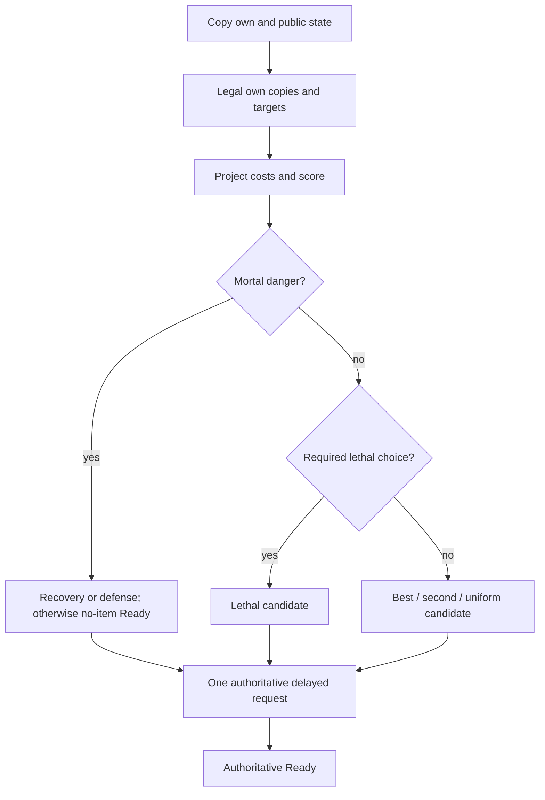

# Solo bot setup

Current integration: **2026-10-14**, isolated worktree `C:/Users/paek6/AbsoluteZero-SoloIntegration`, branch `codex/solo-bot-integration-20261013`. This work has not been merged into original main. [Specification](Plans/PLAN_solo_bot_main_integration_20261013.md) and [execution evidence](Validation/solo_bot_main_integration_20261013.md) distinguish current passes, controlled fixtures, natural games and shipping approval.

## Play the development version

1. Open saved `Assets/Scenes/LobbyScene.unity`, or run the freshly built integration Development Player.
2. Click **1대 봇 대전**, select **초급** or **상급**, then explicitly start the match. Merely selecting a profile does not acquire a session.
3. Play the existing 1v1 rules in `GameScene_Solo`. Human mini-games remain unchanged. The bot models an item's mini-game outcome once, waits its effective delay and uses the authoritative selection/Ready boundary.
4. Results, replay and lobby return use the existing Solo lifecycle. A simultaneous-death draw replays the round without awarding a win.

One local NGO host owns two logical participants. The bot is server-owned; there is no external bot player or second phase driver. Cold Solo does not initialize Authentication/Lobby/Relay. Opening a gameplay scene alone is not a normal launch route.

## Configuration

| Asset | Responsibility |
|---|---|
| `Encounters/BeginnerSoloDuel.asset`, `AdvancedSoloDuel.asset` | Stable encounter ID, bot/difficulty, Ready state, shared rule and dedicated scene |
| `Bots/DefaultBot.asset` | Identity/appearance, compiled graph, inherited stats, base delay policy and knowledge |
| `Difficulties/Beginner.asset`, `Advanced.asset` | Judgment probabilities, extra item delay, reserve and bounded retry |
| `ItemUse/StandardItemUsePolicy.asset` | Base per-item delays; difficulty override replaces the whole policy |
| `Knowledge/DefaultItemKnowledge.asset` | Current catalog item worth, mini-game tier and scoring coefficients; verify its saved binding in the workbench |
| `Graphs/SoloDuelDecision.asset` | Compiled production decision graph |
| `Stats/NeutralInherited.asset` | Current shared starting temperature/fan/grants; custom overrides remain disabled |

Paths above are relative to `Assets/Data/Solo/`. The old Default encounter/NeutralBaseline remain compatibility profiles; do not use them as evidence that a named difficulty was selected.

Current **provisional** Beginner/Advanced settings: zero thinking, AfterSelection Ready, reserve0.25s and retry budget2. Beginner adds2s to effective item delays and uses best/second/uniform selection chances0.60/0.25/0.15; Advanced adds0s and uses0.90/0.08/0.02. Mini-game outcome chances depend on item tier. Read the workbench's resolved per-item table rather than assuming one universal delay. Normal integrated entry currently rejects nonzero thinking or NearDeadline Ready; those older boundary-fixture values are not normal difficulty options.

Every independent configuration needs a unique lowercase ID and positive version. Resolved settings are copied at launch; editing assets during play does not retune a running match. Preserve catalog ordering, item values and shared rules.

## Decision and ownership

- `TurnManager` owns phases and the committed input window.
- `BotTurnController` owns one manually ticked graph run per generation/round/turn/sequence.
- `TrustedBotCommandAdapter` validates bot identity; `BotItemUseOperation` owns one outcome roll, delay, cancellation and idempotency.
- Existing `PlayerState` and combat systems own queueing, consumption and effects. A failed bot mini-game consumes once without an item effect.
- `MatchSessionRouter` owns exclusive session lifetime and normal cleanup/re-entry.

The model reads own inventory and public temperatures/fans/Ready/held-item information. It does not read the opponent's unannounced selection or future RNG. Survival, defense, delayed effects and item value are estimates; actual shared combat remains authoritative. [Current graph/code guide](SOLO_BT_AUTHORING.md).

## Validation and shipping

The latest ledger records controlled graph/operation checks, explicit Beginner/Advanced natural completion, shared-mode regressions and ordinary guard tests separately. The old sixty-match campaign is an old-bot balance baseline, not new-bot evidence. Automated policies and simulated client verdicts do not establish human fairness or manual mini-game usability.

For named-profile natural evidence use the integration `.codex/scripts/run_full_match_playtest.py` with **all three** `--solo-encounter-id`, `--solo-difficulty-id` and `--solo-build-manifest`, plus unique case/attempt/output identities. The manifest must match the executable/assemblies/serialized runtime and effective settings. Exact commands/seeds are retained in the successful I07 evidence folders. Legacy helpers selecting the default profile do not qualify this new cohort.

Development-only `--az-solo-local-port` isolates tests from an existing Editor's local server. Its default remains18777 and the override is absent in ordinary builds. Do not kill an unrelated Editor to free a port or change shared transport rules.

**Beginner/Advanced settings are approved for the current build by the user on2026-10-14.** Only their two difficulty approval flags and StandardItemUsePolicy's flag changed; numeric tuning and GUIDs stayed unchanged. Both actual source profiles started through normal menu events and the ordinary AppBootstrapper coordinator/default18777 port; graph/Ready, Advanced replay and normal stop passed. The final uninstrumented standard Windows build succeeded. See the ledger's current-build activation section for exact build/runtime scope. Legacy NeutralBaseline/DefaultItemUsePolicy remain provisional; new or changed tuning still requires deliberate acceptance. The earlier unsaved-copy approval guard is historical pre-promotion evidence. Use `--plan036-release-approved-source` for the instrumented current approved-source check; the old provisional-menu assertion is for pre-approval data. Main merge, push, deployment and human final balance acceptance are not implied.

Custom starting stats/loadouts, human play-feel acceptance and prolonged soak are separate scope. Read evidence in the ledger before calling any check passed. Keep this guide in `Docs`, with one authoritative copy per code worktree.
